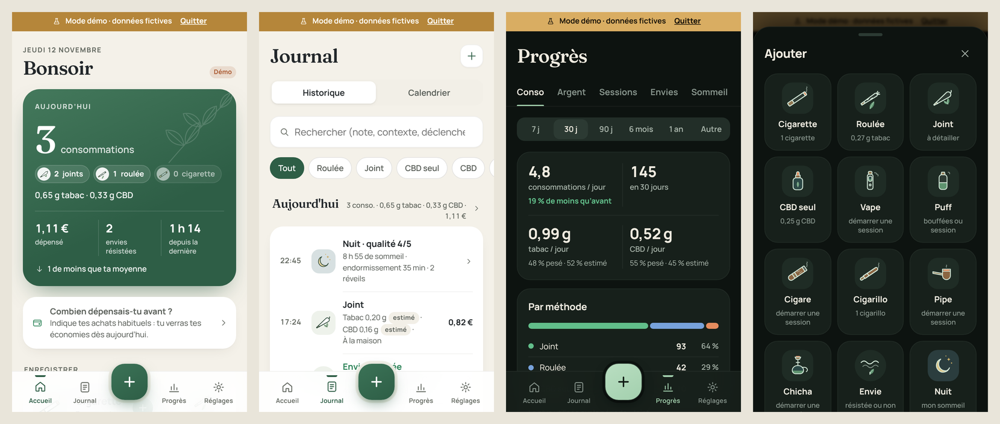

# TRACK THE SMOKE — système de design

Direction artistique : **Nature premium / Modern wellness**. Une application calme, élégante et lisible, à consulter chaque jour : ni tableau de bord automatique, ni application médicale.

Cette refonte ne modifie ni la logique métier ni les données. Seules la feuille de style, les illustrations et la présentation des écrans ont changé.

## 1. Audit de l'existant (avant refonte)

| Constat | Conséquence | Réponse |
|---|---|---|
| Trois couches de styles empilées (V1 sombre, refonte blanc & vert, ajouts V2), avec des `!important` | Règles contradictoires, rendu imprévisible | Feuille unique, structurée en 15 sections, sans `!important` sur les couleurs |
| Un seul vert pour tout (actions, cartes, graphiques, icônes) | Aucune hiérarchie | Vert forêt pour l'action, sauge pour le secondaire, palette de données distincte |
| Mode sombre presque à un seul niveau de surface | Monochrome, plat | Fond, carte, carte intérieure, contrôle, contrôle pressé : 5 niveaux |
| Police système partout | Aucune personnalité | Manrope (interface et chiffres) + Fraunces (titres éditoriaux) |
| Icônes génériques et colorées au hasard | Méthodes difficiles à distinguer | Illustrations vectorielles par méthode et par type d'événement |
| Accueil : pile de cartes de même poids | Lecture lente | Résumé fort, puis raccourcis, puis informations secondaires |
| Graphiques plats, grille pleine | Aspect « généré » | Dégradés, grille pointillée, apparition animée |

## 2. Couleurs

Les deux modes sont définis indépendamment (`css/app.css`, sections 2 et 3).

### Mode clair

| Rôle | Jeton | Valeur |
|---|---|---|
| Fond ivoire chaud | `--bg` | `#F4F1E9` |
| Zone en retrait | `--bg-2` | `#ECE8DE` |
| Carte | `--card` | `#FFFFFF` |
| Surface intérieure de carte | `--card-2` | `#FAF8F3` |
| Contrôle / pressé | `--surface` / `--surface-2` | `#F2EFE7` / `#E5E1D6` |
| Texte anthracite | `--text` | `#22272A` |
| Texte secondaire / tertiaire | `--text-2` / `--text-3` | `#5B605A` / `#666B63` |
| Action principale (vert forêt) | `--primary` | `#2E5E46` |
| Secondaire (vert sauge) | `--sage`, `--sage-soft`, `--sage-ink` | `#7F9D88`, `#E6ECE3`, `#3E5C48` |
| Argent / achats (miel) | `--honey` | `#B5863A` |

### Mode sombre

| Rôle | Jeton | Valeur |
|---|---|---|
| Fond vert-noir profond | `--bg` | `#0D1310` |
| Carte vert ardoise | `--card` | `#17201B` |
| Surface intérieure | `--card-2` | `#1D2822` |
| Contrôle / pressé | `--surface` / `--surface-2` | `#222E28` / `#2C3A33` |
| Texte ivoire | `--text` | `#EFEBE0` |
| Texte gris sauge | `--text-2` / `--text-3` | `#A7B3A9` / `#85928A` |
| Accent sauge lumineux | `--primary` | `#A3D0AE` |
| Liseré de carte | `--card-border` | ivoire à 6 % |

En mode sombre, les ombres sont remplacées par des différences de surface et des liserés fins.

### Données (graphiques)

Les couleurs de données sont des variables de thème, recalées pour chaque mode :

| Rôle | Jeton | Clair | Sombre |
|---|---|---|---|
| Feuille (CBD, envies résistées) | `--c1` | `#2F855A` | `#62BE8A` |
| Ardoise (tabac) | `--c2` | `#4A72A6` | `#77A2DB` |
| Terre cuite (attention) | `--c3` | `#A9572D` | `#E58C5E` |
| Bruyère | `--c4` | `#8767A6` | `#AE90D6` |

### Contraste (WCAG 2.1)

| Paire | Ratio |
|---|---|
| Texte / fond (clair) | 13,4 |
| Texte secondaire / carte (clair) | 6,4 |
| Texte tertiaire / fond (clair) | 4,8 |
| Blanc / vert forêt | 7,5 |
| Texte / fond (sombre) | 15,8 |
| Texte tertiaire / carte (sombre) | 5,1 |
| Sauge / carte (sombre) | 9,7 |

Tous les textes atteignent au moins 4,5:1. `prefers-contrast: more` renforce encore le texte secondaire et les filets.

## 3. Typographie

Les deux polices sont auto-hébergées (`assets/fonts`, licence OFL) et précachées pour le hors-ligne. Elles pèsent 61 ko au total.

- **Manrope** (variable 200–800) : interface, chiffres (`tabular-nums`), boutons.
- **Fraunces** (variable) : titres de page, grand chiffre du jour, montants d'économies, noms de projets, jours du journal.

| Niveau | Usage | Style |
|---|---|---|
| Display | Titre de page, salutation | Fraunces 32 / 560 |
| Héros | Chiffre du jour | Fraunces 64 / 500 |
| Titre 1 | Titre de feuille | Manrope 20 / 800 |
| Titre 2 | Titre de carte | Manrope 16 / 750 |
| Corps | Texte courant | Manrope 15 / 450 |
| Statistique | Indicateurs | Manrope 22–25 / 750 |
| Note | Texte secondaire | Manrope 12,5–13 / 600 |
| Surtitre | Sections, dates | Manrope 11,5 / 750, capitales, +0,1 em |

## 4. Espacements, rayons, ombres

- **Espacements** : base 4 (`--s1` à `--s8`), marge latérale `--gutter` de 18 px (14 px sur iPhone SE).
- **Rayons** : 8, 12, 16, 22 (cartes), 28 (feuilles, résumé du jour).
- **Ombres** (mode clair) : `--shadow`, très diffuse, décalée vers le bas. En mode sombre : aucune, remplacée par `--card-border`.

## 5. Iconographie et illustrations

- **Icônes d'interface** (`js/ui/icons.js`) : traits de 1,6 px, extrémités arrondies, grille de 24. La variante `bold` est réservée au bouton central.
- **Illustrations** (`js/ui/art.js`) : dessins au trait fin sur une grille de 48, colorés avec une palette de « matières » (`--art-paper`, `--art-tan`, `--art-wood`, `--art-glass`, `--art-leaf`, `--art-ember`, `--art-smoke`…), redéfinie pour chaque mode.
  - Méthodes : cigarette, roulée, joint, CBD, vape, puff, cigare, cigarillo, pipe, chicha, personnalisée.
  - Événements et objets : envie, nuit, achat, stock, statistiques, objectifs, projet, argent, paquet, session.
  - Les objets longilignes sont présentés en diagonale, et leur fumée reste verticale.
  - Toutes les illustrations sont décoratives (`aria-hidden`) : le libellé est toujours porté par le texte voisin.
- **Rameau botanique** (`sprig`) : ornement discret dans le résumé du jour et sur l'écran d'accueil.

## 6. Composants

| Composant | Règle |
|---|---|
| Carte | Blanche (clair) ou ardoise (sombre), rayon 22, padding 18. À réserver aux blocs autonomes. |
| Section | Surtitre en capitales, sans cadre. Regroupe sans multiplier les cartes. |
| Liste groupée | Lignes de 52 px séparées par des filets, dans une seule carte. |
| Bouton principal | Vert forêt, rayon 15, état pressé plus sombre et réduit à 97 %. |
| Bouton secondaire | Surface neutre. |
| Contrôle segmenté | Piste `--surface`, segment actif en carte avec une ombre légère. |
| Onglets (Progrès) | Texte souligné d'un trait animé. |
| Puces | Contour fin ; une puce sélectionnée est pleine en vert forêt. |
| Champs | Carte bordée, focus avec halo `--primary-soft`. |
| Feuilles | Fond `--bg`, rayon 28, ouverture en ressort ; leur contenu apparaît en cascade. |
| Toasts | En haut d'écran, avec une coche qui se dessine (ou « ! » pour un avertissement). |
| Badges de fiabilité | pesé, estimé, ≈ auto, provisoire : petites capsules teintées. |

## 7. Écrans

- **Accueil** :
  - surtitre de la date, salutation en Fraunces ;
  - **résumé du jour** en dégradé vert forêt : grand chiffre, puces illustrées par méthode, quantités, puis trois indicateurs séparés par des filets (dépense, envies résistées, temps depuis la dernière consommation) et la comparaison avec ta moyenne ;
  - raccourcis : la méthode principale occupe une tuile large, les autres méthodes et « Envie » des tuiles illustrées, « Autre » en pointillés pour compléter la grille ;
  - ensuite économies, paquets, projet, semaine, puis la journée.
- **Journal** :
  - jours en Fraunces, avec le résumé du jour à droite ;
  - chaque type d'événement a son médaillon illustré :
    - consommation : illustration de la méthode ;
    - session : pastille verte, qui pulse si la session est en cours ;
    - envie : médaillon rond, titre vert si elle a été résistée ;
    - achat : teinte miel ;
    - nuit : teinte nocturne.
- **Progrès** :
  - onglets soulignés, période dans un contrôle segmenté ;
  - indicateurs séparés par des filets verticaux ;
  - barres en dégradé qui poussent à l'apparition, courbes tracées avec aire en fondu, répartitions animées ;
  - légendes à pastilles, info-bulles sur fond élevé.
- **Navigation** : barre translucide floutée ; l'onglet actif est marqué d'un trait supérieur. Le bouton central (60 px, carré arrondi en dégradé, détouré du fond) pivote à 45° quand une feuille est ouverte et pulse à chaque enregistrement.

## 8. Mouvement

- **Courbes** : `--ease` `cubic-bezier(.22, 1, .36, 1)` et `--ease-spring` `cubic-bezier(.32, .72, 0, 1)`.
- **Durées** : 160 / 240 / 420 ms.
- **Pages** : apparition en cascade (30 ms entre blocs, 150 ms au plus).
- **Feuilles** : ressort, contenu en cascade.
- **Validation** : coche dessinée dans le toast et pulsation du bouton central.
- **Objectifs** : les anneaux se remplissent.
- **Statistiques** : barres, courbes et répartitions s'animent à chaque mise à jour.
- `prefers-reduced-motion` désactive toutes les animations.

## 9. Responsive et iOS

- Zones de sécurité (`env(safe-area-inset-*)`) en haut (bandeau démo, toasts, feuilles) et en bas (barre, feuilles, actions fixes).
- Vérifié sur iPhone SE, iPhone 14 et iPhone 14 Pro Max : aucun débordement horizontal ni texte tronqué involontaire. Les seuls éléments à défilement horizontal sont les puces, les onglets et la période.
- Cibles tactiles d'au moins 38 px (44 à 74 px pour les gestes principaux).

## 10. Étendre le système

- Nouvelle couleur : l'ajouter dans **les deux** blocs de tokens, puis vérifier le contraste.
- Nouvelle méthode : ajouter son dessin dans `ART` (grille de 48, classes `a-ln`, `a-paper`, `a-leaf`…), et l'inscrire dans `DIAGONAL` si l'objet est longiligne.
- Nouveau bloc d'écran : partir d'une section (surtitre et contenu) ; ne créer une carte que si le bloc est autonome.
